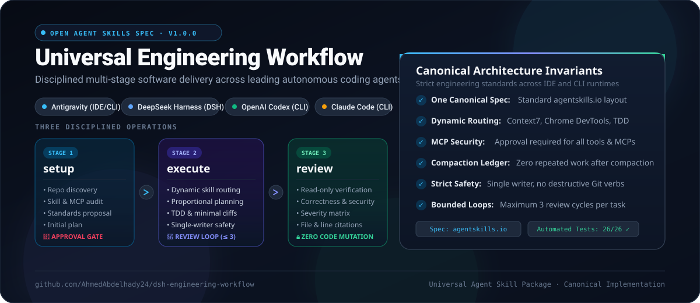

# Universal Engineering Workflow



A portable, production-quality Agent Skills package implementing a disciplined multi-stage software engineering workflow across:

1. **Google Antigravity IDE / CLI**
2. **DeepSeek Harness (DSH)**
3. **OpenAI Codex CLI / IDE**
4. **Claude Code**

Built strictly to the **Agent Skills open specification** ([agentskills.io](https://agentskills.io/specification)), this package provides **one canonical implementation** that runs reliably across all four agent platforms without custom daemons, background runtimes, or vendor lock-in.

> **Note on DSH Evolution**: Formerly the DSH Engineering Workflow Cordis plugin (`v0.1.0` – `v0.2.2`, now archived in [`baseline/`](baseline/)). It has evolved into a universal, runtime-agnostic Agent Skill conforming to open standards. See [`docs/MIGRATION_FROM_DSH.md`](docs/MIGRATION_FROM_DSH.md) for the complete migration audit.

---

## Architecture & Core Operations

The workflow standardizes software engineering tasks into three distinct operations:

```text
               ┌────────────────────────────────────────────────────────┐
               │              engineering-workflow Router               │
               └──────────────────────────┬─────────────────────────────┘
                                          │
                 ┌────────────────────────┼────────────────────────┐
                 ▼                        ▼                        ▼
      ┌────────────────────┐   ┌────────────────────┐   ┌────────────────────┐
      │       setup        │   │      execute       │   │       review       │
      ├────────────────────┤   ├────────────────────┤   ├────────────────────┤
      │ • Repo inspection  │   │ • Task triage      │   │ • Read-only audit  │
      │ • Capability audit │   │ • On-demand skills │   │ • Correctness/sec  │
      │ • Standards prop.  │   │ • Minimal changes  │   │ • Severity matrix  │
      │ • Initial plan     │   │ • TDD verification │   │ • File:line links  │
      │ • 🛑 APPROVAL GATE │   │ • Review loop (≤3) │   │ • Zero code edits  │
      └────────────────────┘   └────────────────────┘   └────────────────────┘
```

| Operation | Primary Command | Objective | Reference Guide |
| :--- | :--- | :--- | :--- |
| **`setup`** | `/engineering-workflow setup` | Codebase discovery, skill/MCP audit, standards proposal, initial plan, and **Approval Gate**. | [`references/setup.md`](skill/engineering-workflow/references/setup.md) |
| **`execute`** | `/engineering-workflow execute` | Proportional planning, specialist skill routing, minimal tested changes, review loop, and final acceptance. | [`references/execute.md`](skill/engineering-workflow/references/execute.md) |
| **`review`** | `/engineering-workflow review` | Objective, read-only multi-axis audit (correctness, security, performance, a11y) with structured findings. | [`references/review.md`](skill/engineering-workflow/references/review.md) |

---

## Key Invariants

1. **Strict Git Safety**:
   - Inspects `git status` before touching files; protects concurrent work from other sessions.
   - Destructive Git operations (`git reset --hard`, `git clean -fd`, `git push --force`) are prohibited.
   - Requires explicit human approval before any commit, push, or branch switch.
2. **Single-Writer Rule**: Only one active writer per file or worktree. Planning and Review roles are strictly read-only.
3. **Bounded Review Loop**: Maximum 3 fix-and-verify iterations between Reviewer and Executor.
4. **Non-Destructive Setup**: Existing repository instructions (`AGENTS.md`, `CLAUDE.md`, `.cursorrules`) are never overwritten blindly.
5. **Context Compaction Recovery**: Utilizes native platform compaction alongside a persistent [`TASK_RECOVERY_LEDGER.md`](templates/TASK_RECOVERY_LEDGER.md) to resume execution without repeating completed edits.
6. **Dynamic Specialist Routing**: Preloads nothing unnecessarily. Activates TDD, debugging, Matt Pocock skills, or UI skills strictly on demand. Pure backend projects classify UI capabilities as **NOT APPLICABLE**.

---

## Installation & Deployment

### 1. Project-Local Installation (Recommended)
Installs the canonical skill into the current repository:

```bash
# Install for all detected agents (writes to .agents/skills)
bash scripts/install.sh --scope project

# Or target a specific host environment:
bash scripts/install.sh --target antigravity-ide --scope project
bash scripts/install.sh --target antigravity-cli --scope project
bash scripts/install.sh --target dsh             --scope project
bash scripts/install.sh --target codex           --scope project
bash scripts/install.sh --target claude          --scope project
```

### 2. User-Global Installation
Installs the skill globally for your user account into official agent directories:

```bash
# Install across all supported global environments:
bash scripts/install.sh --scope global

# Or target specific global agent directories:
bash scripts/install.sh --target antigravity-ide --scope global  # ~/.gemini/config/skills/
bash scripts/install.sh --target antigravity-cli --scope global  # ~/.gemini/antigravity-cli/skills/
bash scripts/install.sh --target dsh             --scope global  # ~/.dsh/skills/
bash scripts/install.sh --target codex           --scope global  # ~/.agents/skills/
bash scripts/install.sh --target claude          --scope global  # ~/.claude/skills/
```

### 3. Open Skills CLI (`skills.sh`)
If using the open Skills CLI (`npx skills`):

```bash
npx skills add ./skill/engineering-workflow
```

### 4. Rollback & Uninstallation
Safely removes the skill without affecting any other skills or project files:

```bash
bash scripts/uninstall.sh --scope project
# Or global:
bash scripts/uninstall.sh --scope global
```

---

## Invocation Across Platforms

| Platform | Primary Invocation | Fallback Prompt Mention |
| :--- | :--- | :--- |
| **Antigravity IDE** | `/engineering-workflow <setup \| execute \| review>` | `@engineering-workflow <op>` or `"Use engineering-workflow to..."` |
| **Antigravity CLI** | `/engineering-workflow <setup \| execute \| review>` | `@engineering-workflow <op>` or `"Use engineering-workflow to..."` |
| **DeepSeek Harness (DSH)** | `/engineering-workflow <setup \| execute \| review>` | Prompt mention or `tool-skill` |
| **OpenAI Codex** | `$engineering-workflow <setup \| execute \| review>` | Prompt mention |
| **Claude Code** | `/engineering-workflow <setup \| execute \| review>` | Prompt mention |

Once a project has completed onboarding with `setup`, subsequent sessions naturally follow the generated [`AGENTS.md`](templates/AGENTS.md) without repeating full initialization instructions.

---

## Model Context Protocol (MCP) Integration

The workflow integrates standard MCP servers:

- **Context7 (`upstash/context7`)**: Baseline live documentation provider. Used for official version-specific library docs, migrations, and unfamiliar APIs.
- **Chrome DevTools MCP (`chrome-devtools-mcp`)**: Required browser testing and runtime verification engine for web applications (DOM, console errors, visual screenshots).
- **Security & Approvals**: Zero embedded credentials. All MCP connections require user authorization.

For host-by-host configuration snippets, see [`references/mcps.md`](skill/engineering-workflow/references/mcps.md).

---

## Multi-Agent Workflow Roles

```text
┌────────────────┐          ┌────────────────┐          ┌────────────────┐
│ 1. Planner     │  ─────►  │ 2. Executor    │  ─────►  │ 3. Reviewer    │
│ (Read-Only)    │          │ (Single Writer)│          │ (Read-Only)    │
└────────────────┘          └────────────────┘          └────────────────┘
        ▲                                                       │
        └─────────────── [Fix Loop: Max 3 Cycles] ──────────────┘
```

1. **Native Delegation**: Uses native subagent isolation when supported (Antigravity `invoke_subagent`, DSH Cordis agents, Codex/Claude child processes).
2. **Sequential Fallback**: When process isolation is unavailable, roles execute sequentially within the same context, honestly disclosing that independent subagent isolation was unavailable.

---

## Repository Structure

```text
dsh-engineering-workflow/
├── skill/
│   └── engineering-workflow/
│       ├── SKILL.md                  # Canonical Agent Skills entry point
│       └── references/
│           ├── setup.md              # Setup operation guide & approval gate
│           ├── execute.md            # Execute operation guide, TDD & review loops
│           ├── review.md             # Review operation guide & severity taxonomy
│           ├── skill-routing.md      # Dynamic capability matrix & non-UI gating
│           ├── mcps.md               # Context7 & Chrome DevTools MCP policy
│           ├── context-recovery.md   # Compaction recovery & Task Recovery Ledger
│           └── agent-compatibility.md# Host mapping across all supported environments
├── templates/
│   ├── AGENTS.md                     # Reusable root agent instructions
│   ├── README.md                     # Project README template
│   ├── TASK_RECOVERY_LEDGER.md       # Task Recovery Ledger template
│   ├── CAPABILITY_READINESS_REPORT.md# Setup readiness audit template
│   ├── docs/
│   │   ├── ENGINEERING_STANDARDS.md  # Engineering quality & testing standards
│   │   ├── ARCHITECTURE.md           # System topology & ADRs
│   │   └── UI_STANDARDS.md           # UI design tokens & WCAG accessibility
│   └── compatibility/
│       ├── CLAUDE.md                 # Thin reference pointer for Claude Code
│       └── GEMINI.md                 # Thin reference pointer for Antigravity
├── scripts/
│   ├── install.sh                    # Multi-host portable installer
│   ├── uninstall.sh                  # Safe rollback script
│   └── validate-skill.mjs            # Agent Skills specification validator
├── tests/
│   ├── spec-compliance.test.mjs      # Specification & frontmatter tests
│   ├── host-discovery.test.mjs       # Cross-host directory discovery tests
│   ├── operations-contract.test.mjs  # setup/execute/review contract tests
│   ├── capability-routing.test.mjs   # Dynamic routing & non-UI gating tests
│   ├── mcp-policies.test.mjs         # MCP rules & zero-credential checks
│   ├── repository-safety.test.mjs    # Git dirty state & overwrite protection tests
│   ├── context-recovery.test.mjs     # Recovery ledger & post-compaction tests
│   ├── installer.test.mjs            # Installation & uninstallation tests
│   └── fixtures/                     # Test fixtures (empty, backend, frontend, monorepo)
├── docs/
│   ├── COMPATIBILITY_MATRIX.md       # Cross-agent compatibility deep dive
│   ├── MIGRATION_FROM_DSH.md         # Migration audit from legacy Cordis plugin
│   ├── VERIFICATION_EVIDENCE.md      # Verified test evidence & disclosures
│   └── visuals/                      # Workflow architecture diagrams
├── baseline/                         # Preserved snapshots of legacy DSH releases
│   ├── v0.1.0/
│   ├── v0.2.0/
│   ├── v0.2.1/
│   └── v0.2.2/                       # Final Cordis plugin release snapshot
├── package.json                      # Scripts & metadata
├── LICENSE                           # MIT License
└── README.md                         # This documentation
```

---

## Validation & Testing

Run the automated test suite with zero external dependencies:

```bash
# Run all 26 automated tests across fixtures
npm test

# Run Agent Skills specification validator
npm run validate
```

---

## In-Depth Documentation Links

- **[Cross-Agent Compatibility Matrix](docs/COMPATIBILITY_MATRIX.md)**
- **[DSH Plugin Migration Audit](docs/MIGRATION_FROM_DSH.md)**
- **[Verification Evidence & Execution Logs](docs/VERIFICATION_EVIDENCE.md)**

---

## License

MIT © 2026 Ahmed Abdelhady
