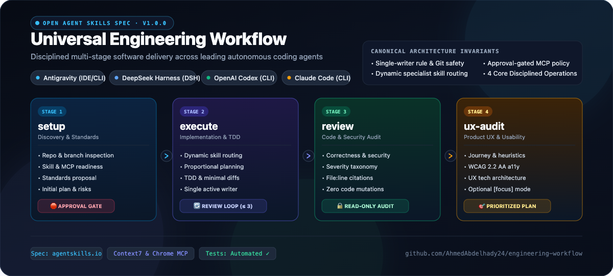

# Universal Engineering Workflow

[](https://agentskills.io/specification)
[](LICENSE)
[](tests/)
[](docs/architecture/)

The compaction-proof orchestrator for real software engineering — not vibe coding.



Developing production applications with coding agents is hard. Monolithic frameworks try to help by owning the process, locking your terminal into rigid state machines and stripping away human control. At the other extreme, unguided agents fly without a compass, hallucinate passing tests, and suffer from total amnesia the moment context compacts.

**Universal Engineering Workflow** provides the missing discipline: four lean operations (`setup`, `execute`, `review`, `ux-audit`), an ironclad **Skill Execution Contract**, a compaction-proof recovery ledger, and end-to-end runtime verification across Claude Code, OpenAI Codex, Google Antigravity, and DeepSeek Harness.

---

## 30-Second Setup

A plugin updates automatically. Pick your environment below:

### 1. Install

<details open>
<summary><strong>Claude Code</strong> (Plugin Marketplace)</summary>

```bash
claude plugin marketplace add AhmedAbdelhady24/engineering-workflow
claude plugin install engineering-workflow@AhmedAbdelhady24
```

*Updates automatically on startup.*

</details>

<details>
<summary><strong>OpenAI Codex</strong> (Plugin Marketplace)</summary>

```bash
codex plugin marketplace add AhmedAbdelhady24/engineering-workflow
codex plugin add engineering-workflow@AhmedAbdelhady24
```

*Updates automatically on startup.*

</details>

<details>
<summary><strong>Google Antigravity / Gemini CLI</strong> (Native Skills)</summary>

```bash
# Global installation
gemini skills install https://github.com/AhmedAbdelhady24/engineering-workflow.git --path skills/engineering-workflow

# Or project-local installation
bash scripts/install.sh --target antigravity-ide --scope project
```

</details>

<details>
<summary><strong>Open Skills CLI (skills.sh / Cursor / Windsurf / OpenCode)</strong></summary>

```bash
npx skills add AhmedAbdelhady24/engineering-workflow
```

</details>

<details>
<summary><strong>Direct Shell Installer (Universal)</strong></summary>

```bash
# Project-local installation (.agents/skills/engineering-workflow)
curl -fsSL https://raw.githubusercontent.com/AhmedAbdelhady24/engineering-workflow/master/install.sh | bash -s -- --scope project

# User-global installation
curl -fsSL https://raw.githubusercontent.com/AhmedAbdelhady24/engineering-workflow/master/install.sh | bash -s -- --scope global
```

</details>

### 2. Run `/engineering-workflow setup`

In your agent's chat or CLI, run setup once per repository:

```bash
/engineering-workflow setup
```

The orchestrator will:
1. Inspect the codebase, package managers, and test runners.
2. Audit installed skills, MCP tools, and runtime capabilities.
3. Detect your issue tracker (GitHub Issues, GitLab, Jira, or local files).
4. Initialize the compaction-proof `TASK_LOG.md` and `RECOVERY_LEDGER.md`.
5. Halt at an explicit **Approval Gate** before modifying any code.

### 3. You're ready to engineer.

---

## Why Universal Engineering Workflow Exists

Built to eliminate the four fatal failure modes of AI-assisted software engineering:

### #1: The Process Hijack vs. Pure Chaos

> "Simplicity is prerequisite for reliability."
> — Edsger W. Dijkstra

**The Problem**: Monolithic autonomous frameworks lock you out of your terminal with heavy runtimes, background daemons, and brittle state graphs. If an agent hits a bug, you cannot steer it. At the other extreme, unguided vibe-coding agents quickly descend into chaotic edits, unverified assumptions, and destructive Git commands.

**The Fix**: Four transparent, composable operations that guide the agent without hijacking control:
- **[`setup`](./skill/engineering-workflow/references/setup.md)**: Audits the repo, establishes test gates, initializes recovery ledger, and halts at an Approval Gate.
- **[`execute`](./skill/engineering-workflow/references/execute.md)**: Executes specs in thin, test-driven vertical slices with a single-writer rule and bounded review loops.
- **[`review`](./skill/engineering-workflow/references/review.md)**: Strictly read-only, two-axis verification (Repo standards + Originating spec compliance).
- **[`ux-audit`](./skill/engineering-workflow/references/ux-audit.md)**: Evaluates real-world product usability, visual hierarchy, and accessibility via live browser automation.

### #2: Hallucinated Skill Execution ("I totally used TDD")

> "Without data, you're just another person with an opinion."
> — W. Edwards Deming

**The Problem**: Agents often have access to great specialist skills (`tdd`, `codebase-design`, `grill-with-docs`, `systematic-debugging`), but merely mention them in conversation without actually invoking them. The agent claims it followed TDD, but wrote the implementation first, added tests as an afterthought, or skipped testing altogether.

**The Fix**: The **Skill Execution Contract**.
Before taking action, the agent must:
1. Match the task archetype against the **Task-to-Skill Consideration Matrix**.
2. Verify the selected specialist skill is installed in the current host environment.
3. Explicitly invoke the skill through the host's supported mechanism.
4. Report concrete runtime evidence (test commands, logs, exit codes) in the completion report.

```markdown
- **Skills Execution Summary**:
  - **Skills Considered**: [`grill-with-docs`, `domain-modeling`]
  - **Skills Actually Invoked**: [`tdd` (ran `npm test` red -> green), `Ponytail` (minimal focused diff)]
  - **Skills Missing / Blocked**: [None]
```

### #3: Post-Compaction Amnesia

> "Those who cannot remember the past are condemned to repeat it."
> — George Santayana

**The Problem**: As conversations stretch past context limits, the host environment compacts or truncates history. The agent loses track of architectural boundaries, forgets what files were already edited, repeats completed work, and re-introduces previously solved bugs.

**The Fix**: The **Compaction-Proof Engineering Ledger**.
Every session persists a lightweight [`TASK_LOG.md`](./templates/TASK_LOG.md) and [`RECOVERY_LEDGER.md`](./templates/TASK_RECOVERY_LEDGER.md) with explicit checkpoint boundaries. If context compacts or the session restarts, the agent reads the ledger and reconciles disk status, resuming immediately from the last incomplete step with zero loss of momentum.

### #4: Code Passes CI, But the Experience Is Broken (The UX Blindspot)

> "Design is not just what it looks like and feels like. Design is how it works."
> — Steve Jobs

**The Problem**: AI-generated code frequently passes unit tests and TypeScript compilation, but fails catastrophically in the browser: modals trap keyboard focus, mobile viewports overflow, forms lack validation feedback, empty states are missing, and key user flows take five confusing clicks.

**The Fix**: **`ux-audit`**.
Walks real user journeys using live browser automation (Playwright or Chrome DevTools MCP), scores 10 Nielsen usability heuristics (1–5 scale), verifies WCAG 2.2 AA accessibility compliance, and produces concrete, reproducible fixes with file:line references.

---

## Operations & Skills Taxonomy

### User-Invoked Operations

Direct commands triggered by humans in the agent chat or CLI:

| Operation | Command | Primary Purpose | Deliverable |
| :--- | :--- | :--- | :--- |
| **`setup`** | `/engineering-workflow setup` | Codebase discovery, skill audit, tracker detection, baseline plan | `TASK_LOG.md`, `RECOVERY_LEDGER.md`, Approval Gate |
| **`execute`** | `/engineering-workflow execute` | Spec-driven, test-driven implementation in thin vertical slices | Verified code diffs, passing tests, execution evidence |
| **`review`** | `/engineering-workflow review` | Independent, read-only code review along Standards and Spec axes | Two-axis review report with file:line severity findings |
| **`ux-audit`** | `/engineering-workflow ux-audit [focus]` | Live browser walkthrough, usability heuristics, accessibility | Usability scorecard (1–5), WCAG findings, visual fixes |

### Dynamic Specialist Skill Integration

Universal Engineering Workflow acts as an orchestrator that dynamically activates specialist skills on demand:

| Task Archetype | Specialist Skills Considered | Primary Purpose & Execution Intent |
| :--- | :--- | :--- |
| **New feature with unclear requirements** | `grilling`, `grill-with-docs`, `domain-modeling` | Socratic interview; clarifying domain models and entities before writing code. |
| **Architecture planning** | `codebase-design`, `implementation-planning` | Deep module boundaries, small interfaces hiding complexity, vertical slices. |
| **Feature implementation** | `implement`, `Ponytail`, `test-driven-development` | Guided plan execution, minimal/focused changes without bloat, TDD loop. |
| **Bug fixing** | `systematic-debugging`, `test-driven-development` | Root-cause reproduction before mutation, failing regression tests, verifying fixes. |
| **Engineering handoff** | `handoff` | Packaging structured context packages and recovery ledgers for peer agents. |
| **UX audit** | `ui-ux-pro-max`, `frontend-design`, `make-interfaces-feel-better`, `break-ui`, `browser-testing-with-devtools` | Usability heuristics, visual design, micro-interactions, WCAG 2.2 AA testing. |
| **Simple change** | `Ponytail` principles, focused verification | Minimal complete diff, zero speculative abstractions, focused unit testing. |

---

## Repository Structure

Built strictly to the [Agent Skills open specification](https://agentskills.io/specification). Pure markdown, JSON manifests, and standard shell scripts — zero proprietary binaries or background daemons.

```text
engineering-workflow/
├── .claude-plugin/                    # Native Claude Code & Codex Marketplace
│   ├── marketplace.json               # Registers repository as an installable plugin catalog
│   └── plugin.json                    # Plugin manifest with operations & metadata
├── .changeset/                        # Automated semantic releases & changelogs
│   └── config.json
├── .agents/adr/                       # Architectural Decision Records
│   ├── 0001-skill-execution-contract.md
│   ├── 0002-compaction-proof-ledger.md
│   └── 0003-ux-audit-framework.md
├── scripts/
│   ├── sync-plugin-version.mjs        # Synchronizes versions across manifests
│   ├── validate-skill.mjs             # Schema & reference integrity validator
│   ├── install.sh                     # Multi-host installation script
│   └── uninstall.sh                   # Clean removal script
├── skill/engineering-workflow/        # Canonical Agent Skill implementation
│   ├── SKILL.md                       # Core router & Skill Execution Contract
│   └── references/
│       ├── setup.md                   # Discovery & approval gate
│       ├── execute.md                 # TDD, single-writer & review loop
│       ├── review.md                  # Read-only audit & severity taxonomy
│       ├── ux-audit.md                # 6-stage usability & accessibility audit
│       ├── skill-routing.md           # Dynamic specialist consideration matrix
│       ├── mcps.md                    # Context7 & Chrome DevTools policies
│       ├── context-recovery.md        # Compaction recovery protocol
│       └── agent-compatibility.md     # Multi-agent roles & host invocations
├── skills/engineering-workflow/       # Agent Skills standard mirror (strictly synced)
├── templates/                         # TASK_LOG, RECOVERY_LEDGER, Standards
├── tests/                             # Automated test suite (41 tests)
├── package.json
└── README.md
```

---

## Core Invariants & Safety

1. **Strict Git Safety**:
   - Inspects `git status` before touching files; protects concurrent work from other sessions.
   - Destructive Git operations (`git reset --hard`, `git clean -fd`, `git push --force`) are prohibited.
   - Requires explicit human approval before any commit, push, or branch switch.
2. **Single-Writer Rule**: Only one active writer per file or worktree. Planning and Review roles are strictly read-only.
3. **Bounded Review Loop**: Maximum 3 fix-and-verify iterations between Reviewer and Executor.
4. **Non-Destructive Setup**: Existing repository instructions (`AGENTS.md`, `CLAUDE.md`, `.cursorrules`) are never overwritten blindly.
5. **Context Compaction Recovery**: Utilizes native platform compaction alongside a persistent [`TASK_RECOVERY_LEDGER.md`](templates/TASK_RECOVERY_LEDGER.md) to resume execution without repeating completed edits.
6. **Dynamic Specialist Routing**: Preloads nothing unnecessarily. Activates TDD, debugging, Matt Pocock skills, or UI skills strictly on demand. Pure backend projects classify UI capabilities as **NOT APPLICABLE**.

---

## Verification & Testing

The repository includes a comprehensive automated test suite verifying spec compliance, routing rules, installer behavior, recovery protocols, and UX audit contracts:

```bash
# Run the automated test suite (41 tests)
npm test

# Validate Agent Skills specification compliance
npm run validate

# Verify plugin manifest version synchronization
npm run check-plugin-version
```

---

## Rollback & Uninstallation

Safely removes the skill without affecting any other skills or project files:

```bash
# Project-local removal:
bash scripts/uninstall.sh --scope project

# Global removal:
bash scripts/uninstall.sh --scope global
```

---

## License

[MIT License](LICENSE) &copy; Ahmed Abdelhady
