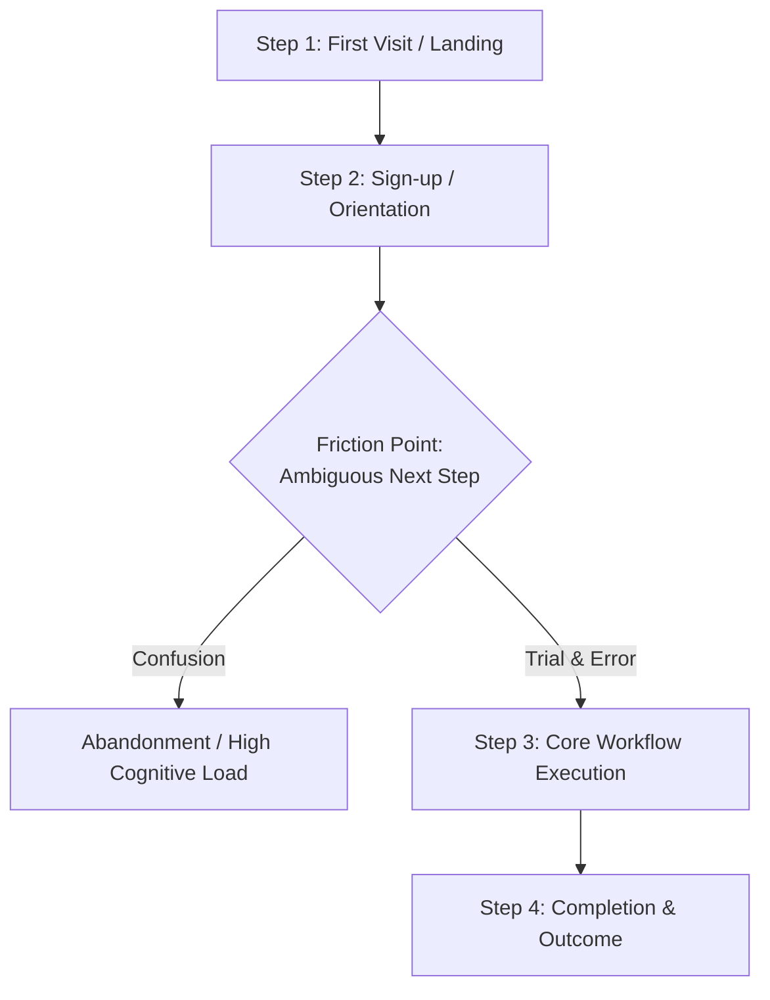
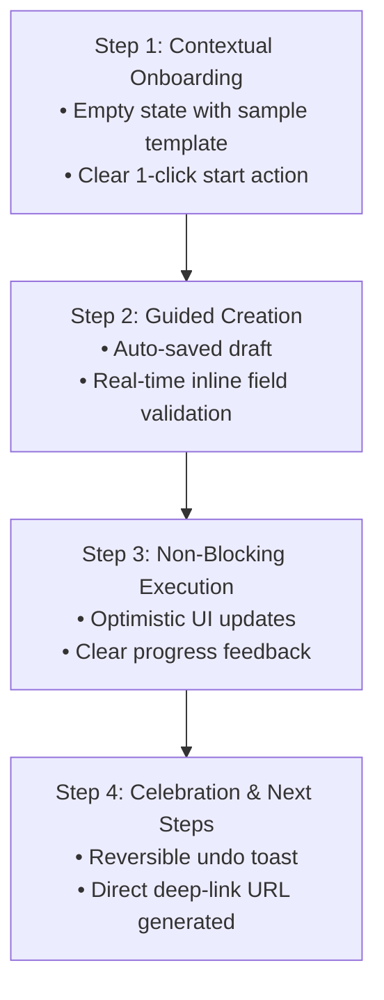

# Product Usability, UI/UX & Technical UX Audit Report

**Product / Application**: {{PRODUCT_NAME}}  
**Target Focus**: {{AUDIT_FOCUS: Comprehensive | Onboarding | Navigation | Accessibility | <Custom Flow>}}  
**Audit Date**: {{DATE}}  
**Auditor Role**: Principal Product Designer, Accessibility Specialist & Staff Frontend Engineer  
**Tested Environment**: {{TEST_ENVIRONMENT: e.g. Local Dev (localhost:3000) / Staging / Production}}  
**Browser / Testing Tooling**: {{TOOLING: e.g. Chrome DevTools MCP, Playwright, Manual Browser Walkthrough}}

---

## 1. Executive Summary

- **High-Level Assessment**: {{Summary of product usability, key user friction points, and overarching architectural health}}
- **Overall Usability Score**: {{Average Score: X.X / 5.0}}
- **Critical Blockers Found**: {{Count}}
- **High / Medium UX Issues**: {{Count}}
- **Top 3 Actionable Recommendations**:
  1. {{Recommendation 1}}
  2. {{Recommendation 2}}
  3. {{Recommendation 3}}

---

## 2. Product Purpose & Target Users

- **Primary Product Objective**: {{What core problem does this application solve?}}
- **Target Personas & User Segments**:
  - **Primary User**: {{Persona, technical skill level, primary jobs-to-be-done}}
  - **Secondary / Admin User**: {{Operational or management persona}}
- **Primary Jobs-to-be-Done (JTBD)**:
  - *When I... [context/trigger]*
  - *I want to... [user action]*
  - *So that I can... [desired outcome/value]*

---

## 3. Audit Scope & Tested Environments

- **Evaluated Scope**: {{Full Application | Specific Workflow: onboarding / navigation / accessibility / checkout}}
- **Tested Viewports & Resolutions**:
  - Desktop: `1440 × 900` / `1280 × 800`
  - Tablet: `768 × 1024` (iPad Mini / Air)
  - Mobile: `375 × 812` (iPhone SE / 13)
- **Assistive Technologies & Emulations**: {{Keyboard-only tab navigation, VoiceOver/NVDA, prefers-reduced-motion, high contrast}}
- **Tooling Availability & Limitations**:
  - Browser Automation: `{{ACTIVE | NOT TESTED (manual fallback)}}`
  - DOM / Console Diagnostics: `{{AVAILABLE | UNAVAILABLE}}`

---

## 4. Current-State User Journey

- **Friction Bottlenecks**: {{Summary of where users drop off, get confused, or face excessive interaction cost}}

---

## 5. Observed User Journey Walkthrough

| Step | User Goal | Observed Behavior & UX Obstacles | Evidence Type | Severity |
| :--- | :--- | :--- | :--- | :--- |
| **1. Onboarding** | First-time orientation | {{e.g. Blank dashboard with no call-to-action}} | `Observed` | `HIGH` |
| **2. Initiation** | Start primary task | {{e.g. Button placed below the fold}} | `Observed` | `MEDIUM` |
| **3. Navigation** | Switch between sections | {{e.g. URL query params not updated, back button exits}} | `Code-Supported` | `HIGH` |
| **4. Progression** | Multi-field form entry | {{e.g. Missing inline validation; error only on submit}} | `Observed` | `HIGH` |
| **5. Feedback** | Loading and save confirmation | {{e.g. Indefinite spinner; no success toast}} | `Observed` | `MEDIUM` |
| **6. Recovery** | Recover from mistake / cancel | {{e.g. Destructive delete has no confirmation or undo}} | `Code-Supported` | `CRITICAL` |
| **7. Completion** | Finalize task & verify result | {{e.g. Abrupt redirect without summary of progress}} | `Observed` | `LOW` |

---

## 6. Usability Scorecard

Evaluated against Nielsen's 10 Heuristics and modern product interaction standards (1 = Critical Failure, 5 = Exceptional):

| Usability Dimension | Score (1–5) | Key Observation & Evidence Reference | Evidence Classification |
| :--- | :---: | :--- | :--- |
| **1. Purpose & Mental Model Alignment** | {{3/5}} | {{Match between user expectations and system representation}} | `Observed` |
| **2. First-Time Usability & Onboarding** | {{2/5}} | {{Clarity of initial empty states and setup guides}} | `Observed` |
| **3. Information Architecture & Navigation** | {{3/5}} | {{Discoverability of routes, menus, and search palettes}} | `Code-Supported` |
| **4. Visibility of System Status** | {{3/5}} | {{Skeletons, progress indicators, and loading feedback}} | `Observed` |
| **5. User Control & Emergency Exits** | {{2/5}} | {{Availability of undo, cancel, modal dismissal}} | `Observed` |
| **6. Consistency & Standards** | {{4/5}} | {{Visual rhythm and design token reuse}} | `Code-Supported` |
| **7. Error Prevention & Recovery** | {{2/5}} | {{Inline field validation and plain-language messages}} | `Observed` |
| **8. Recognition vs. Recall** | {{3/5}} | {{Contextual cues vs. forcing user memory burden}} | `Hypothesis` |
| **9. Progressive Disclosure & Cognitive Load** | {{3/5}} | {{Tiered complexity vs. overwhelming settings views}} | `Code-Supported` |
| **10. Task Efficiency & Accelerators** | {{3/5}} | {{Keyboard navigation, shortcuts, and batch flows}} | `Observed` |
| **11. Visual Hierarchy & Spacing** | {{4/5}} | {{4/8px spatial scale, typographic readability}} | `Observed` |
| **12. Interactive States & Micro-interactions** | {{3/5}} | {{Hover, active, focus-visible, and disabled clarity}} | `Observed` |
| **13. Accessibility (WCAG 2.2 AA)** | {{2/5}} | {{Color contrast, screen-reader semantics, focus traps}} | `Observed` |
| **14. Responsive Layout Adaptability** | {{3/5}} | {{Mobile 375px behavior and touch-target sizing}} | `Observed` |
| **15. Trust, Confidence & Polish** | {{3/5}} | {{Data safety reassurance, confirmation toasts}} | `Observed` |

---

## 7. UI & Accessibility Findings

### [UX-A11Y-01] {{Title: e.g. Insufficient Text Contrast on Secondary Badges}}
- **WCAG Criterion**: {{WCAG 2.2 AA — 1.4.3 Contrast (Minimum)}}
- **Observed Contrast**: {{e.g. 2.8:1 (Expected: minimum 4.5:1)}}
- **Affected Elements**: `{{Selector / Component: e.g. .badge-secondary in src/components/Badge.tsx}}`
- **Impact**: Low-vision users and users in bright environments cannot read status pills.
- **Remediation**: Adjust text token to `{{#hex}}` or background to `{{#hex}}`.

### [UX-UI-01] {{Title: e.g. Missing Focus Rings on Modal Action Buttons}}
- **Criterion**: {{WCAG 2.2 AA — 2.4.7 Focus Visible}}
- **Observed Behavior**: Tabbing through modal leaves keyboard users without visual indicator.
- **Affected Elements**: `{{src/components/Modal.tsx#L85-L102}}`
- **Remediation**: Add `focus-visible:ring-2 focus-visible:ring-sky-500 focus-visible:outline-none`.

---

## 8. UX-Related Technical Findings

### [UX-TECH-01] {{Title: e.g. Stale Data Flash on Tab Switching}}
- **Technical Mechanism**: {{e.g. Component re-mounts on route change without caching prior query state, flashing an empty table before re-fetching}}
- **Source Citation**: `src/path/to/File.tsx#L40-L65` (cite exact component file and line range)
- **UX Manifestation**: Jarring layout flicker every time user toggles between active and archived tabs.
- **Confirmed vs. Hypothesis**: `Confirmed Defect`
- **Technical Recommendation**: {{e.g. Enable TanStack Query placeholderData / keepPreviousData or hoist state to persistent store}}

### [UX-TECH-02] {{Title: e.g. Unsubmitted Form State Wiped on Navigation}}
- **Technical Mechanism**: {{e.g. Form state managed solely in local component useState without localStorage persistence or leave-page guard}}
- **Source Citation**: `src/path/to/Form.tsx#L18-L35` (cite exact component file and line range)
- **UX Manifestation**: User loses all multi-paragraph inputs if they accidentally click outside or refresh.
- **Confirmed vs. Hypothesis**: `Confirmed Defect`
- **Technical Recommendation**: {{e.g. Implement auto-save draft in localStorage or prompt with beforeunload guard}}

---

## 9. Screenshots & Supporting Evidence

| Figure | Description & Scenario | Viewport | Evidence Type |
| :--- | :--- | :--- | :--- |
| **Fig 1** | {{e.g. Empty state missing onboarding guide}} | Desktop (1440px) | Screenshot (`docs/visuals/fig1.png`) |
| **Fig 2** | {{e.g. Form input error overflow on mobile}} | Mobile (375px) | Screenshot (`docs/visuals/fig2.png`) |
| **Fig 3** | {{e.g. Console error during async mutation}} | Browser Tools | Console Log Extract |

---

## 10. Proposed Future-State Experience

- **Key UX Transformation**: {{Describe how the proposed flow eliminates friction, reduces cognitive load, and increases task completion rate}}

---

## 11. Prioritized Improvement Backlog

### Tier A: Quick Wins (Low Effort, High Immediate Impact)

| ID | Issue & Location | Severity | Effort | Expected Benefit |
| :--- | :--- | :---: | :---: | :--- |
| **UX-01** | {{e.g. Add explicit focus-visible rings to modal actions}} | `HIGH` | `S` | Instant keyboard accessibility compliance. |
| **UX-02** | {{e.g. Clarify button label 'Submit' -> 'Create Tracking Project'}} | `MEDIUM` | `S` | Eliminates hesitation on final creation step. |
| **UX-03** | {{e.g. Add empty state illustration and CTA when list is empty}} | `MEDIUM` | `S` | Guides first-time users directly into active workflow. |

### Tier B: Workflow & Interaction Improvements (Medium Effort)

| ID | Issue & Location | Severity | Effort | Expected Benefit |
| :--- | :--- | :---: | :---: | :--- |
| **UX-04** | {{e.g. Replace destructive modal with inline confirm and undo toast}} | `HIGH` | `M` | Prevents accidental data deletion with zero friction. |
| **UX-05** | {{e.g. Sync filter and search state to URL query parameters}} | `MEDIUM` | `M` | Allows users to bookmark and share specific filtered views. |
| **UX-06** | {{e.g. Responsive mobile navigation drawer and touch target padding}} | `HIGH` | `M` | Makes web app fully operable on smartphone screens. |

### Tier C: Architectural Improvements (High Effort, Foundational Value)

| ID | Issue & Location | Severity | Effort | Expected Benefit |
| :--- | :--- | :---: | :---: | :--- |
| **UX-07** | {{e.g. Implement draft auto-persistence in IndexedDB / localStorage}} | `HIGH` | `L` | Zero data loss on network failure or tab reloads. |
| **UX-08** | {{e.g. Batch N+1 API calls and add server-side pagination}} | `MEDIUM` | `L` | Eliminates 2-second UI freezes when loading large lists. |

---

## 12. Proposed Implementation Milestones

- **Milestone 1 (Immediate - Days 1–2)**: Deliver Tier A Quick Wins (accessibility focus rings, contrast fixes, button label clarity).
- **Milestone 2 (Sprint 1)**: Deliver Tier B Workflow improvements (onboarding empty states, URL parameter sync, undo toasts).
- **Milestone 3 (Sprint 2)**: Deliver Tier C Architectural upgrades (draft persistence, query caching, performance tuning).

---

## 13. Open Product Decisions

1. **Decision 1**: {{e.g. Should free-tier users be guided through an automated onboarding wizard or dropped directly into the blank canvas?}}
2. **Decision 2**: {{e.g. Should deletions require typing the project name or rely on an instant undo toast notification?}}

---

## 14. Recommended Validation Strategy

### Usability Test Protocol
- **Test Cohort**: {{3–5 representative users}}
- **Core Scenario**: {{e.g. "Create a new project, invite a collaborator, and export the summary report."}}

### Measurable Target Benchmarks

| Metric | Current Baseline (Estimated / Audited) | Target Post-Improvement |
| :--- | :---: | :---: |
| **Time to First Useful Outcome (TTFUO)** | {{e.g. 145 seconds}} | **< 45 seconds** |
| **Task Completion Rate** | {{e.g. 68%}} | **> 95%** |
| **Navigation Detour / Confusion Count** | {{e.g. 4.2 errors / session}} | **< 1.0 error / session** |
| **Form Abandonment Rate** | {{e.g. 24%}} | **< 5%** |
| **Single Ease Question (SEQ, 1–7)** | {{e.g. 4.1 / 7}} | **> 6.2 / 7** |
